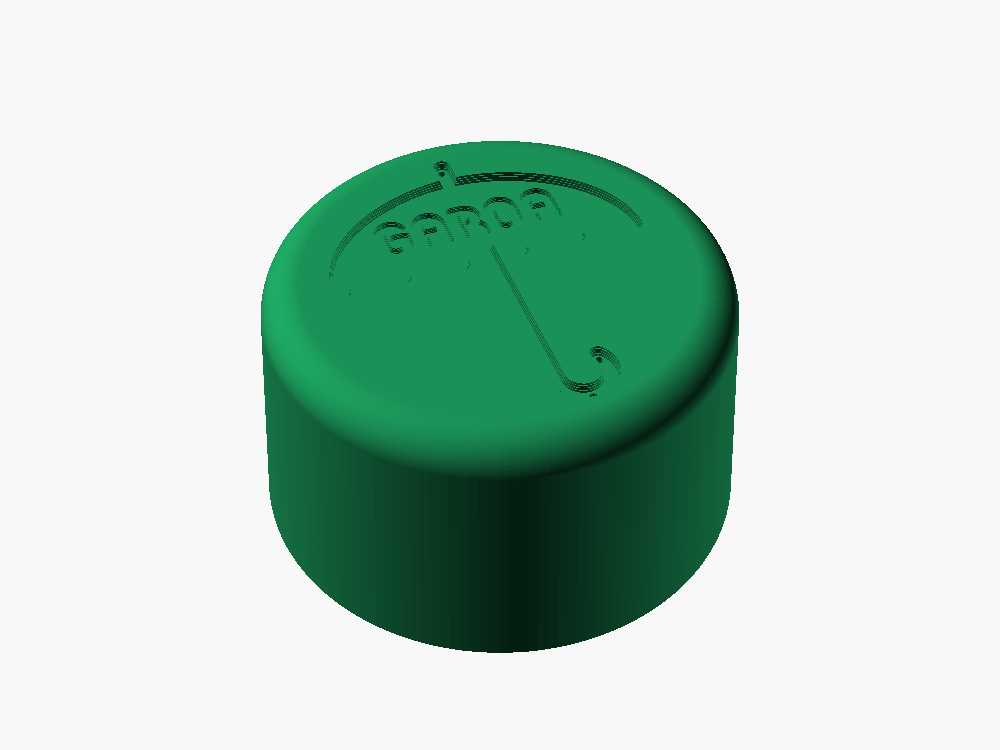
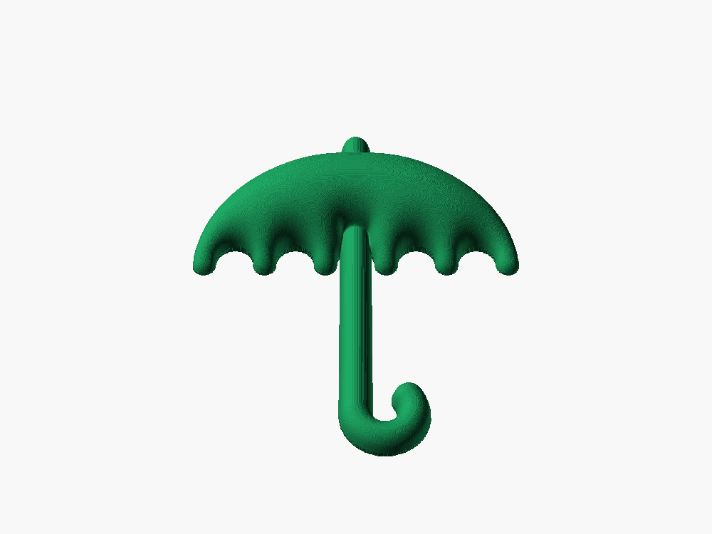
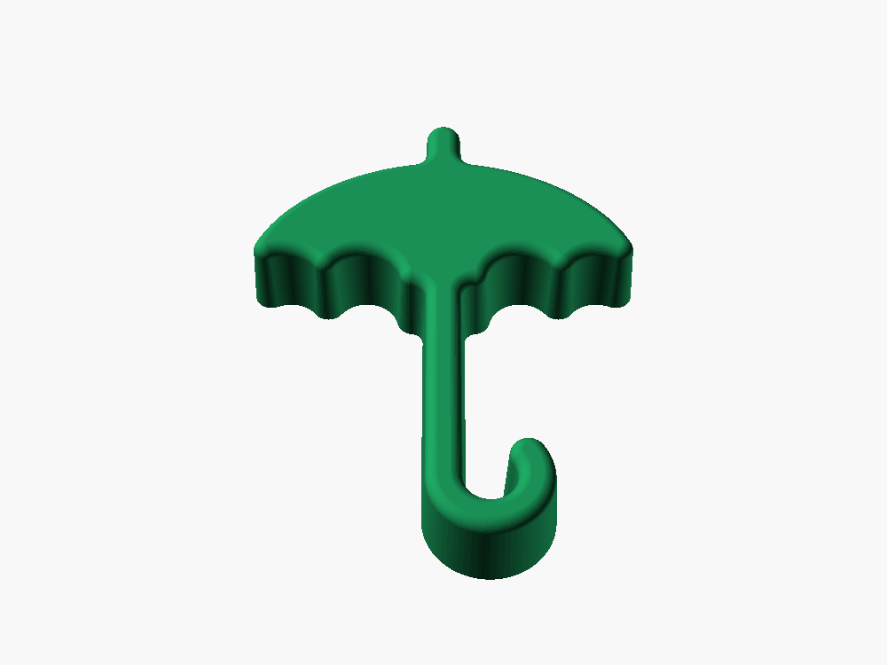
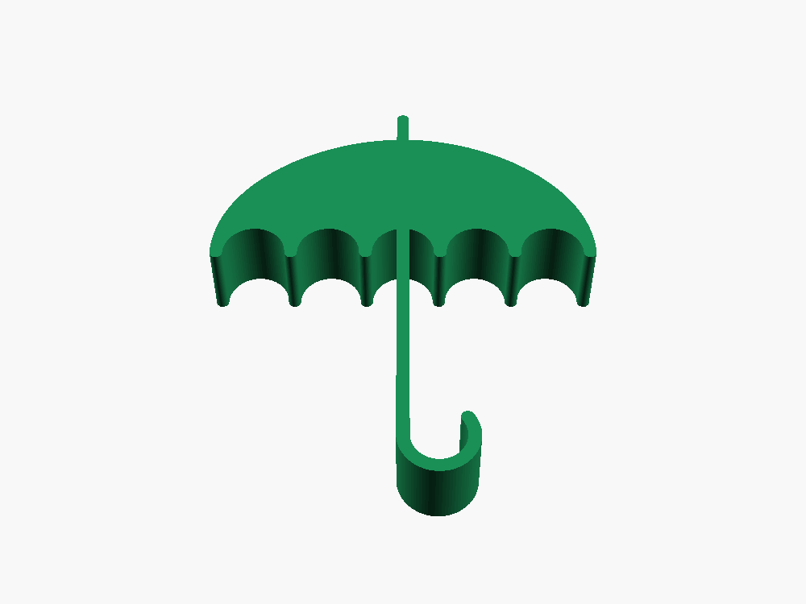
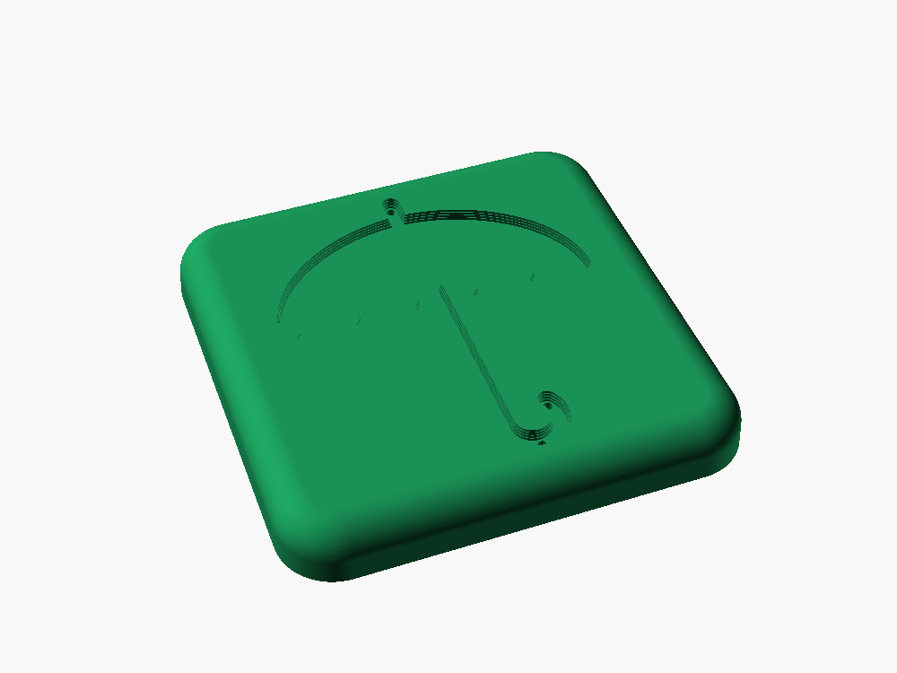

# Garoa Candies — formas de doces com o logo do Garoa

Fluxo completo para fazer formas de chocolate / pão de mel com o logo do
Garoa Hacker Clube:

```
Logo_Garoa.svg ──(make_logo_circle.py)──> out/*.svg, *.png
                                            │
                    (pao_de_mel_disco_logo.scad) <──┘
                              │
                              v
                   out/pao_de_mel_disco_logo.stl ──(impressora 3D)──> mestre impresso
                                                                   │
                                     (vacuum forming com PETG) <───┘
                                                 │
                                                 v
                                     forma de plástico ──> doces
```

O **mestre** é a peça impressa sobre a qual o plástico quente é puxado pelo
vácuo. A cavidade da forma copia o mestre, então **o doce sai com o mesmo
formato do mestre**.

Doces disponíveis (cada um é um `.scad` em `tools/` que gera um `.stl` em `out/`):

| Doce | STL | Formato | Seção |
|---|---|---|---|
| Pão de mel com o logo | `pao_de_mel_disco_logo.stl` | Disco de 50 × 28 mm, borda arredondada, guarda-chuva e GAROA cavados no topo | 2 |
| Guarda-chuva abaulado | `guarda_chuva_abaulado.stl` | Copa abaulada como uma esfera, cabo grosso, ~60 × 70 × 11 mm | 7 |
| Guarda-chuva reto arredondado | `guarda_chuva_reto_arredondado.stl` | Silhueta reta de 10 mm, com saída, topo arredondado e cabo grosso, ~46 × 60 mm | 8 |
| Guarda-chuva extrudado puro | `guarda_chuva_extrudado_puro.stl` | Silhueta do logo extrudada 10 mm, sem nenhum ajuste, 48 × 55 mm | 8 |
| Quadrado com guarda-chuva | `quadrado_guarda_chuva.stl` | Bloco de 40 × 40 × 5 mm, borda arredondada, guarda-chuva cavado no topo | 9 |

| Pão de mel | Abaulado | Reto arredondado | Extrudado puro | Quadrado |
|:---:|:---:|:---:|:---:|:---:|
|  |  |  |  |  |

As imagens são renderizadas dos STLs pelo OpenSCAD, em verde. Para gerar de
novo, na raiz do repositório (troque o nome do doce e, para os de logo cavado, use
`--camera=0,0,0,45,0,-20,0`, que mostra melhor o logo):

```sh
echo "color(\"#1a8f55\") import(\"$PWD/out/guarda_chuva_abaulado.stl\");" > /tmp/r.scad
openscad -o img/guarda_chuva_abaulado.png --imgsize=1000,750 \
  --camera=0,0,0,38,0,0,0 --viewall --autocenter --colorscheme=Tomorrow /tmp/r.scad
```

## Arquivos

| Arquivo | O que é |
|---|---|
| `Logo_Garoa.svg` | Logo original, com os pontinhos de chuva (abra e edite no [Inkscape](https://inkscape.org)) |
| `tools/make_logo_circle.py` | Limpa o logo e gera os SVGs/PNGs em `out/` |
| `tools/pao_de_mel_disco_logo.scad` | Modelo 3D paramétrico do mestre (OpenSCAD) |
| `out/garoa_circulo.svg` | Logo limpo para visualização (guarda-chuva preto, GAROA vazado) |
| `out/garoa_circulo_2048*.png`, `.webp` | Mesmo logo em imagem 2048 px |
| `out/garoa_umbrella.svg`, `out/garoa_text.svg` | Guarda-chuva e texto separados, usados pelo `.scad` |
| `out/garoa_circulo_3d.svg` | Tudo num arquivo só, em grupos `umbrella` / `text` (para Tinkercad, Blender etc.) |
| `tools/guarda_chuva_abaulado_altura.py` | Calcula o mapa de altura do guarda-chuva abaulado |
| `tools/guarda_chuva_abaulado.scad` | Transforma o mapa de altura em sólido |
| `tools/guarda_chuva_reto_arredondado.scad` | Guarda-chuva reto com saída e cabo grosso |
| `tools/guarda_chuva_extrudado_puro.scad` | Guarda-chuva do logo só extrudado |
| `tools/quadrado_guarda_chuva.scad` | Bloco quadrado com o guarda-chuva cavado no topo |
| `out/guarda_chuva_abaulado_altura.png`, `.scad` | Mapa de altura e escala, gerados pelo `.py` (não editar) |
| `out/*.stl` | Modelos prontos para fatiar e imprimir |
| `img/*.png` | Imagens renderizadas dos doces, usadas neste README |

Requisitos: Python 3 (só biblioteca padrão), [OpenSCAD](https://openscad.org)
2021+, [Inkscape](https://inkscape.org) para abrir e medir os SVGs e, para os PNGs, `rsvg-convert` (`brew install librsvg`) e `cwebp`
(`brew install webp`).

---

## 1. Script Python: `tools/make_logo_circle.py`

```sh
python3 tools/make_logo_circle.py Logo_Garoa.svg out
```

### O que ele faz

1. **Lê só a camada visível** do SVG original (`New_lettering_P_x26_B`).
   O arquivo tem outras 3 camadas ocultas (logo antigo, versões verdes) que
   são ignoradas — muitos programas 3D não respeitam `display="none"`.
2. **Remove os pontinhos de chuva.** Eles estão todos no primeiro `<g>` da
   camada; o script pula o grupo inteiro e confere que cada item ali é mesmo
   um ponto pequeno.
3. **Separa as peças pela cor:** o path preto (`#1D1D1B`) é o guarda-chuva;
   os brancos são as letras. Confere que existe 1 guarda-chuva e 16 letras.
4. **Mantém só "GAROA".** As letras com início em `y < 360` são a linha de
   cima (GAROA, 5 letras); "HACKER CLUBE" é descartado.
5. **Amplia o GAROA** em torno do próprio centro (`TEXT_SCALE`) e o desloca
   para baixo (`TEXT_DY`) para ocupar bem o guarda-chuva.
6. **Monta o documento de saída** com `viewBox` começando em `0 0` e tamanho
   físico em mm (`DIAM_MM`). O OpenSCAD importa errado SVGs cujo `viewBox`
   não começa em zero, por isso o deslocamento vai num `transform`.
7. **Opcionalmente desenha um anel** em volta do logo (`BORDA`).

### Constantes (no topo do script)

| Constante | Padrão | Para quê |
|---|---|---|
| `UMB_X0..UMB_Y1` | medido | Caixa do guarda-chuva sem os pontos, nas unidades do SVG original |
| `BORDA` | `False` | `True` desenha o anel em volta do logo |
| `MARGIN`, `RING` | 14 / 10,6 | Folga e espessura do anel (só se `BORDA = True`) |
| `DIAM_MM` | 60 | Tamanho físico do SVG gerado. O `.scad` reescala, não precisa mexer |
| `TEXT_SCALE` | 1,35 | Ampliação do GAROA. Acima de ~1,4 o G encosta na borda do guarda-chuva |
| `TEXT_DY` | 18 | Deslocamento vertical do GAROA (+ = desce) |

### Gerar as imagens

```sh
rsvg-convert -w 2048 -b white out/garoa_circulo.svg -o out/garoa_circulo_2048.png
rsvg-convert -w 2048          out/garoa_circulo.svg -o out/garoa_circulo_2048_transparente.png
cwebp -lossless out/garoa_circulo_2048.png -o out/garoa_circulo_2048.webp
```

---

## 2. Modelo 3D: `tools/pao_de_mel_disco_logo.scad`

```sh
cd tools
openscad --export-format binstl -o ../out/pao_de_mel_disco_logo.stl pao_de_mel_disco_logo.scad
```

Ou abra no OpenSCAD e ajuste os parâmetros em **Window → Customizer**;
depois **F6** (render) e **F7** (exportar STL). O console mostra o tamanho do
topo plano e do logo.

### Formato

- **Corpo:** tronco de cone com 50 mm na base, 28 mm de altura, lateral com
  3° de saída (o topo fica com ~47 mm) e borda superior arredondada com raio
  de 4 mm.
- **Logo (~37 mm) todo em negativo, em dois níveis:**
  - guarda-chuva cavado 1,0 mm;
  - GAROA cavado mais 0,6 mm a partir do fundo do guarda-chuva (1,6 mm do
    topo). Se as letras ficassem no mesmo nível, sumiriam.
- **Paredes do logo com 15° de saída**, abrindo para cima, para o plástico
  soltar do mestre.
- **9 furos de respiro** de 0,8 mm, do fundo do logo até a base (ver seção 3).

### Parâmetros

| Parâmetro | Padrão | Observação |
|---|---|---|
| `D` | 50 | Largura máxima (base do mestre = boca da forma) |
| `altura` | 28 | Altura total do doce |
| `draft` | 3 | Saída da lateral. Menos de 2° prende a forma no mestre |
| `raio` | 4 | Arredondamento da borda de cima |
| `folga` | 1 | Distância entre o logo e o começo da curva |
| `profundidade` | 1,0 | Profundidade do guarda-chuva. Manter ≤ largura do cabo (~1,3 mm) |
| `profundidade_letras` | 0,6 | Degrau extra das letras. Manter ≤ largura do traço (~1 mm) |
| `draft_logo` | 15 | Saída das paredes cavadas |
| `engrossar`, `engrossar_letras` | 0,15 / 0 | Alargam o guarda-chuva e as letras (mm por lado) |
| `respiros`, `d_respiro` | `true` / 0,8 | Furos de respiro |
| `colunas`, `linhas`, `espaco`, `placa` | 1 / 1 / 30 / 0 | Várias cavidades numa placa só (ver seção 5) |
| `passos` | 4 | Fatias das paredes inclinadas do logo (degraus de ~0,25 mm). Mais fatias = paredes mais lisas e STL mais pesado |
| `svg_fn` | 24 | Segmentos por curva do logo. 160 deixava o STL com ~674 mil triângulos sem diferença visível |

O STL sai com ~48 mil triângulos (2,3 MB). Exporte sempre em **binário**
(`--export-format binstl`): em texto ele fica ~5× maior e pode travar o
fatiador.

> Regra de ouro do vacuum forming: **um sulco não deve ser mais fundo do que
> largo.** Se aumentar as profundidades, aumente também `D` (o logo cresce
> junto) ou `engrossar`.

---

## 3. Furos de respiro

### Por que existem

Quando o plástico quente desce sobre o mestre, ele encosta primeiro nas
bordas do logo e **prende o ar** dentro dos sulcos. Sem saída, esse ar
impede o plástico de copiar o fundo do guarda-chuva e das letras — o
detalhe sai borrado ou arredondado.

### Onde ficam

**Os furos ficam no mestre impresso, não no plástico.** A forma de plástico
**não pode ter nenhum furo**, senão o chocolate vaza. Um furo de 0,8 mm no
mestre deixa só um pontinho quase invisível no plástico (e no doce).

Já modelados em `PONTOS_RESPIRO` (no `.scad`), nos pontos onde o ar fica
preso:

- ponta de cima do cabo;
- fundo e ponta do gancho;
- as 6 pontas das "ondinhas" na borda do guarda-chuva.

Cada furo atravessa o mestre inteiro, do fundo do sulco até a base, e o ar
sai pela mesa perfurada da máquina de vácuo.

### O que esperar da impressão

Com bico de 0,4 mm, um furo de 0,8 mm com 27 mm de comprimento costuma sair
**mais estreito que o desenhado, às vezes parcialmente fechado**. Tudo bem:
o principal é que ele **marca a posição exata** e deixa um canal-guia pelo
centro da peça, então furar depois fica fácil e certeiro. Se os furos
estiverem saindo totalmente fechados, aumente `d_respiro` para 1,0 mm no
`.scad` e/ou a "X-Y hole compensation" no fatiador.

### Depois de imprimir

1. **Confira se todos os 9 furos estão abertos.** Furos de 0,8 mm costumam
   fechar parcialmente na impressão. Olhe contra a luz ou sopre pela base.
2. **Desentupa com uma broca de 0,8 mm num mandril manual (pin vise)** ou
   com uma agulha de acupuntura / corda de violão fina. Gire à mão, sem
   furadeira, para não derreter o plástico. Vá dos dois lados (topo e base)
   se precisar.
3. **Coloque o mestre sobre a área perfurada da mesa** da máquina de vácuo,
   para os furos da base terem por onde puxar o ar.

### Se ainda faltar detalhe

Depois do primeiro teste, veja onde o plástico não copiou o fundo e acrescente
furos ali:

- **No arquivo:** adicione o ponto em `PONTOS_RESPIRO` (coordenadas do
  `Logo_Garoa.svg` original — abra no Inkscape e veja a posição do cursor)
  e gere o STL de novo.
- **À mão:** fure com broca de 0,6–0,8 mm direto no mestre impresso. Os
  candidatos mais prováveis são **o miolo das letras A, O e R** e o fundo
  do G, porque as letras são a parte mais funda.

Não use furos maiores que 1 mm: o plástico começa a entrar neles e o doce
fica com "pinos".

---

## 4. Impressão do mestre

O mestre **não encosta no alimento** — quem encosta é a folha de plástico.
Então o material de impressão é escolhido por resistência ao calor e à
pressão, não por ser alimentício.

### Material

| Material | Resiste ao calor? | Quando usar |
|---|---|---|
| **ABS / ASA** | Melhor (amolece ~100 °C) | **Recomendado** se a impressora for fechada (Bambu P1S, X1C, X1E). Aguenta muitas puxadas seguidas |
| **PETG** | Bom (amolece ~80 °C) | Melhor opção em impressora aberta (A1, A1 mini, P1P) ou se nunca imprimiu ABS. Deixe o mestre esfriar entre puxadas |
| PLA | Fraco (amolece ~55–60 °C) | Só para um teste rápido de formato. Deforma depois de poucas puxadas |
| Resina | Bom (resinas "tough"/"high temp") | Melhor acabamento, se tiver impressora de resina |

### Orientação

- Imprima **em pé, com a base na mesa e o logo para cima**, exatamente como
  sai do STL. Assim o logo fica no plano XY, com a melhor definição.
- **Sem suportes**: nada no modelo precisa.

### Configurações — Bambu Studio e OrcaSlicer

Os nomes são praticamente iguais nos dois (o Orca é derivado do Bambu
Studio). Comece pelo perfil **0.12mm Fine** (Bambu) / **0.12mm Fine @BBL**
ou equivalente (Orca), com bico de 0,4 mm, e ajuste:

| Onde | Configuração | Valor | Por quê |
|---|---|---|---|
| Qualidade | Layer height | **0,12 mm** (0,08 mm se quiser ainda mais liso) | Degraus finos na borda arredondada e nos níveis do logo |
| Qualidade | Variable layer height (opcional) | Ativar, suavizar só a curva do topo | Camadas finas onde precisa, rápidas na lateral |
| Qualidade | Wall generator | **Arachne** (padrão) | Reproduz bem traços de ~1 mm |
| Qualidade → Ironing | Ironing type | A opção que passa em **todas as superfícies de topo** (no Bambu Studio, "Top surfaces"; no Orca, o nome equivalente) | Alisa o topo e também o fundo do logo. Não use "Topmost surface": ela só alisa a camada mais alta e deixa o fundo do logo sem alisar |
| Qualidade → Seam | Seam position | **Aligned** ou **Back** | Concentra a emenda numa linha só, fácil de lixar |
| Qualidade → Seam | Scarf joint seam | **Contour** (Orca: Scarf joint placement → Contours, ou equivalente na sua versão) | Emenda quase invisível na lateral, que marcaria o doce |
| Qualidade → Precision | X-Y hole compensation | **+0,1 mm** | Evita que os furos de respiro fechem |
| Qualidade → Precision | Elephant foot compensation | **0,15 mm** | Base sem "pé" alargado |
| Resistência | Wall loops | **4** | Lateral rígida contra o vácuo e o calor |
| Resistência | Top shell layers | **8** (≥ 1 mm) | Topo não afunda com a pressão |
| Resistência | Bottom shell layers | **4** | |
| Resistência | Sparse infill density | **40 %** | Ver abaixo |
| Resistência | Sparse infill pattern | **Gyroid** | Rígido em todas as direções e não marca o topo |
| Velocidade | Outer wall speed | **≤ 100 mm/s** | Acabamento melhor na lateral |
| Suporte | Enable support | **Desligado** | |
| Outros → Brim | Brim type | PETG: **No brim** · ABS/ASA: **Outer brim only, 3–5 mm** | ABS empena; remova o brim com cuidado e lixe a borda da base |

**Preenchimento:** na hora do vácuo, a pressão do ar empurra o plástico
quente contra o mestre com cerca de 1 kg por cm². Com 40 % de gyroid e 8
camadas de topo o mestre fica firme e não afunda; abaixo de ~25 % o topo pode
ceder ao longo das puxadas. 100 % também funciona (fica mais pesado, demora
mais e retém mais calor entre as puxadas). Os furos de respiro ganham
paredes próprias no fatiador, então o ar passa por eles mesmo com o
preenchimento.

**Filamento:**

- **PETG:** bico 240–250 °C, mesa 70–80 °C. Em placa PEI lisa, use cola
  bastão como separador (PETG gruda demais e pode arrancar a camada da placa).
- **ABS/ASA:** bico 250–270 °C, mesa 90–100 °C, **porta e tampa fechadas**,
  ventilador auxiliar desligado ou baixo, sem correntes de ar.

**Antes de imprimir:** na pré-visualização do fatiador, confira por camada
que os 9 furos de respiro existem até a base.

### Acabamento do mestre

Toda marca do mestre passa para o plástico e depois para o chocolate.

1. Lixe a lateral e a curva do topo com lixa d'água 400 → 800 → 1200,
   molhada. Cuidado para não arredondar as bordas do logo.
2. Opcional: uma camada fina de verniz/resina de acabamento (XTC-3D, epóxi)
   deixa a superfície espelhada. ABS pode ser alisado com vapor de acetona,
   mas isso arredonda os detalhes finos do logo — teste antes.
3. Desentupa os furos de respiro de novo depois de lixar ou envernizar.

---

## 5. Vacuum forming

- **Folha (esta encosta no alimento):** **PETG ou PET certificado para
  contato com alimentos**, de **0,75–1,0 mm**. Com 28 mm de altura, a lateral
  estica bastante e uma folha de 0,5 mm fica fina demais nas paredes. Não use
  folha de ABS ou HIPS comum para chocolate.
- **Aquecimento:** aqueça até a folha "embarrigar" de forma uniforme
  (PETG ~140–160 °C, depende da máquina) antes de baixar sobre o mestre.
- **Várias cavidades:** use `colunas`/`linhas` no `.scad`. Deixe `espaco`
  ≥ 30 mm (igual à altura) para o plástico não formar "teias" entre os doces.
  Com `placa > 0`, os furos de respiro atravessam a placa também.
- **Entre puxadas:** deixe o mestre esfriar (especialmente PETG/PLA). Um
  pouco de talco no mestre ajuda a forma a soltar.
- **Depois de formar:** recorte o excesso deixando uma aba de ~10 mm em volta
  da boca de cada cavidade (ajuda a apoiar a forma). **Não fure a forma.**
  Lave com água morna e detergente neutro antes do primeiro uso.

## 6. Problemas comuns

| Sintoma | Causa provável | O que fazer |
|---|---|---|
| Logo borrado / fundo arredondado na forma | Ar preso | Desentupir respiros; adicionar furos nos cantos que falharam |
| Forma não solta do mestre | Pouca saída ou mestre quente | Aumentar `draft` (4–5°); esperar esfriar; talco |
| Plástico com "teias" entre cavidades | Cavidades próximas demais | Aumentar `espaco` |
| Paredes da forma muito finas / rasgam | Folha fina para 28 mm de altura | Folha de 1 mm, ou reduzir `altura` |
| Mestre deformou | Material com pouca resistência ao calor | Trocar para ABS/ASA; resfriar entre puxadas |
| Letras não aparecem no doce | Sulcos rasos ou estreitos demais | Aumentar `profundidade_letras` e `engrossar_letras` (mantendo profundidade ≤ largura) ou `D` |

---

## 7. Segundo doce: guarda-chuva abaulado

Doce no formato do próprio guarda-chuva (sem disco em volta), com a copa
abaulada como uma esfera, bordas arredondadas e cabo e gancho roliços e
grossos (para o chocolate não quebrar). Tamanho padrão: copa com 60 mm de
largura, ~70 mm de comprimento e ~11 mm de altura no ponto mais alto; cabo
com 6 mm de largura e 4,5 mm de altura.

```sh
python3 tools/guarda_chuva_abaulado_altura.py out        # gera o mapa de altura (~5 s)
cd tools && openscad --export-format binstl -o ../out/guarda_chuva_abaulado.stl guarda_chuva_abaulado.scad
```

### Por que um mapa de altura

Modelar isso com CSG no OpenSCAD (cortar por um elipsoide e arredondar com
`minkowski`) ou fica com bordas retas ou leva mais de 10 minutos para gerar.
Em vez disso, `guarda_chuva_abaulado_altura.py` calcula a altura do doce em cada
ponto (0,1 mm) e grava em `out/guarda_chuva_abaulado_altura.png` (preto = 0,
branco = altura máxima); o `.scad` só transforma a imagem em sólido com
`surface()`.

- **Copa:** "inflada" como um balão: o script resolve uma equação de
  Poisson dentro do contorno da copa (o mesmo princípio das ferramentas de
  "inflar" dos programas 3D) e usa a raiz da solução como altura. O topo sai
  redondo e liso e as bordas descem em curva, inclusive em volta das ondinhas.
- **Cabo e gancho:** seção oval calculada pela distância até a linha central
  (reta do cabo + arco do gancho), com medida própria, independente do traço
  fino do logo.
- **GAROA (opcional, desligado):** gravado na copa, com uma rampa curta nas
  bordas das letras.
- **Suavização:** um desfoque leve tira o serrilhado dos pixels.

Um mapa de altura **nunca tem partes "por baixo"** (undercuts), então o
formato é sempre desmoldável no vacuum forming.

### Parâmetros (no topo de `tools/guarda_chuva_abaulado_altura.py`)

| Parâmetro | Padrão | Para quê |
|---|---|---|
| `LARGURA` | 60 | Largura da copa (mm) |
| `ALTURA` | 12 | Altura máxima da copa (mm) |
| `PERFIL` | 0,5 | Forma do "balão": 0,5 = bem redonda; 0,3 = mais cheia, com topo achatado; 0,7 = mais pontuda no centro |
| `ENGROSSAR` | 1,2 | Engrossa o contorno da copa (mm por lado) |
| `LARGURA_CABO`, `ALTURA_CABO` | 6 / 4,5 | Medidas do cabo e do gancho (mm). Em chocolate, não use menos de ~5 mm de largura |
| `TEXTO` | `False` | `True` grava o GAROA na copa |
| `PROF_TEXTO`, `RAMPA_TEXTO` | 0,7 / 0,3 | Profundidade e rampa do GAROA |
| `RESOLUCAO`, `SUAVIZAR` | 0,1 / 2 | Tamanho do pixel (mm) e raio do desfoque (px) |

No `.scad` ficam só `colunas`, `linhas`, `espaco` e `placa`, para várias
cavidades numa placa.

### Impressão e vacuum forming

Valem as mesmas regras das seções 4 e 5. Diferenças:

- Exporte o STL em **binário** (`--export-format binstl`): em texto ele passa
  de 150 MB.
- Não há respiros modelados. Se ligar o `TEXTO`, as letras são a parte mais
  funda e o primeiro lugar para furar à mão (0,6 mm) se saírem borradas.
- As curvinhas entre as ondinhas, na borda da copa, são onde o plástico
  demora mais a encostar; se ficarem arredondadas demais na forma, fure ali.

---

## 8. Terceiro doce: guarda-chuva reto (pequeno)

Só a silhueta do guarda-chuva, sem o GAROA, levantada reta: **~46 mm de
largura, ~60 mm de comprimento e 10 mm de altura** (um pouco menor que o doce
de disco, de 50 mm). Laterais com 3° de saída e borda de cima arredondada
(1,5 mm), para desmoldar no vacuum forming.

A lateral é feita com `minkowski()`: uma ferramenta convexa (tronco de cone
com uma esfera no topo) percorre o contorno, e a saída e o arredondamento
saem como uma superfície lisa só. Empilhar fatias com `offset` deixava
degraus visíveis no arredondamento. Gerar o STL leva ~1 min.

```sh
cd tools && openscad --export-format binstl -o ../out/guarda_chuva_reto_arredondado.stl guarda_chuva_reto_arredondado.scad
```

O cabo e o gancho do logo são finos demais para chocolate, então o `.scad`
os refaz com 5 mm de largura em volta da linha central. O gancho tem raio
próprio (`raio_gancho`), maior que o do logo: com o raio original o vão
interno fechava numa fenda de ~1 mm, onde o plástico não entra.

| Parâmetro | Padrão | Para quê |
|---|---|---|
| `largura` | 48 | Largura da copa (mm) |
| `altura` | 5 | Altura do doce (mm) |
| `draft`, `raio` | 3 / 1,5 | Saída da lateral (graus) e arredondamento da borda de cima (mm) |
| `fechar` | 1,5 | Arredonda as curvinhas entre as ondinhas e junto ao cabo (mm) |
| `largura_cabo`, `raio_gancho` | 5 / 5 | Largura do cabo e raio do gancho (mm); o vão do gancho (2 × raio − largura) deve passar de 2 × `fechar` |
| `colunas`, `linhas`, `espaco`, `placa` | 1 / 1 / 15 / 0 | Várias cavidades numa placa |

As pontas das ondinhas e as pontas da copa ficam arredondadas com o raio da
ferramenta na base (`raio` + saída ≈ 1,9 mm). Por isso o doce sai ~2 mm mais
estreito que `largura`, que mede a copa do logo antes do arredondamento.
Aumentar `raio` deixa as pontas mais rombudas e o doce mais estreito.

### Variante: extrudado puro

`tools/guarda_chuva_extrudado_puro.scad` → `out/guarda_chuva_extrudado_puro.stl` é só
o `linear_extrude()` da silhueta 2D do logo (48 × ~55 × 10 mm): sem saída,
sem arredondamento e com o cabo e o gancho originais, finos (~1,6 mm).

```sh
cd tools && openscad --export-format binstl -o ../out/guarda_chuva_extrudado_puro.stl guarda_chuva_extrudado_puro.scad
```

---

## 9. Quarto doce: quadrado com guarda-chuva

Bloco quadrado de **40 × 40 mm na base e 5 mm de altura**, com o
guarda-chuva do logo (sem o GAROA) **cavado no topo**, em negativo. É o mesmo
princípio do pão de mel da seção 2, com corpo quadrado no lugar do disco.

```sh
cd tools && openscad --export-format binstl -o ../out/quadrado_guarda_chuva.stl quadrado_guarda_chuva.scad
```

- **Corpo:** lateral com 3° de saída (o topo plano fica com ~34 mm), cantos
  verticais arredondados (raio de 5 mm na base) e borda de cima arredondada
  (raio de 3 mm). Tudo sai de um `hull()`, então gera em menos de 1 s.
- **Guarda-chuva (~27 mm de copa, ~31 mm de comprimento):** cavado 1,0 mm,
  com paredes de 15° de saída e alargado 0,15 mm por lado — os mesmos
  valores do pão de mel. Aqui o guarda-chuva é menor, então o sulco do cabo
  fica com ~1,2 mm de largura, no limite da regra da seção 2; se o cabo
  sair borrado, aumente `engrossar` para 0,2.
- **9 furos de respiro** de 0,8 mm nos mesmos pontos do pão de mel (ponta
  do cabo, gancho e pontas das ondinhas). Ver seção 3.

| Parâmetro | Padrão | Para quê |
|---|---|---|
| `lado` | 40 | Lado do quadrado na base (boca da forma) |
| `altura` | 5 | Altura total do doce |
| `draft`, `raio`, `canto` | 3 / 3 / 5 | Saída da lateral (graus), arredondamento da borda de cima e dos cantos verticais (mm) |
| `folga` | 1 | Distância entre o guarda-chuva e o começo da curva; o guarda-chuva cresce junto com `lado` |
| `profundidade`, `draft_logo`, `engrossar` | 1,0 / 15 / 0,15 | Como na seção 2. Manter `profundidade` ≤ largura do cabo (~1,3 mm) |
| `respiros`, `d_respiro` | `true` / 0,8 | Furos de respiro |
| `colunas`, `linhas`, `espaco`, `placa` | 1 / 1 / 20 / 0 | Várias cavidades numa placa |

Impressão e vacuum forming: valem as seções 4 e 5. Com só 5 mm de altura, uma
folha de 0,5–0,75 mm já basta.
